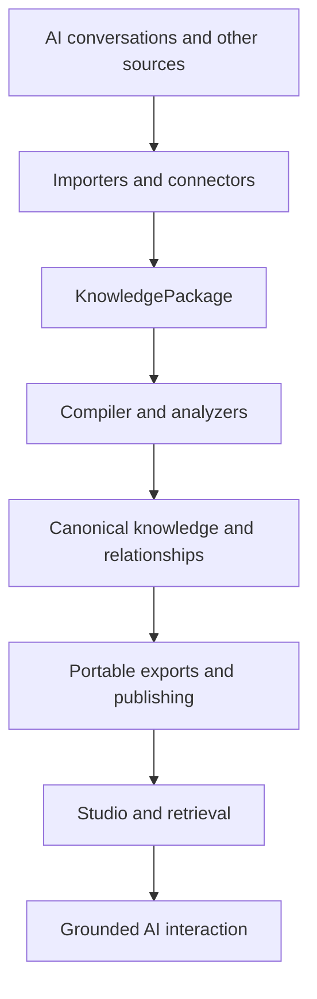

# Oracle Knowledge Platform — Build-First Technical Analysis

**Review date:** 2026-10-22  
**Repository:** [UthieZz/Oracle-Knowledge-Platform](https://github.com/UthieZz/Oracle-Knowledge-Platform)  
**Scope:** Current-main repository review of architecture, implementation evidence, recorded tests, engineering implications, and next-step planning.  
**Purpose:** Explain what OKP has built and why, then use the audit as a practical guide for strengthening the system.

## 1. Executive summary

Oracle Knowledge Platform (OKP) is being built as knowledge infrastructure, not simply as a chatbot or a conversation archive. Its central purpose is to turn fragmented information from AI systems and other sources into structured, reusable, searchable, traceable knowledge that can support more than one interface or model provider.

The repository shows two connected areas of work:

1. **Knowledge Core:** importers, a canonical `KnowledgePackage` representation, compiler/analysis components, retrieval, export paths, and Studio integration.
2. **OKP Connect:** a replaceable source-integration layer with a connector contract, durable SQLite event queue, cursor storage, background worker, local-folder connector, knowledge accumulator, a runner script, and a health-check CLI.

The significant recent milestone is the Connect loop. The documented local-folder path can scan text and Markdown files, emit events, queue and process them in the background, apply creates/updates/deletes to a living package, persist that package as canonical JSON, and expose basic health information. This is a meaningful vertical slice: it connects a real source shape to the existing knowledge model without creating a second intermediate representation.

The design choices are coherent: keep the knowledge model stable, make connectors replaceable, keep source processing separate from queueing, persist operational state, and let retrieval consume the package. These choices reduce coupling and give OKP a route from manual imports toward continuous synchronization.

The next stage is not a wholesale redesign. It is to strengthen the seams between components: connector snapshot recovery, source identity scope, event lifecycle idempotency, cursor/retry behavior, end-to-end permission enforcement, provenance consistency, and repeatable verification. After those boundaries are dependable, onboarding, a supported service deployment, and one real business-system connector can build on the existing foundation.

**Overall assessment:** OKP has a substantive knowledge pipeline and a promising local-first synchronization slice. The repository supports claims of implementation and targeted testing in these areas. It does not, by itself, establish a complete production deployment, enterprise authorization model, full-suite pass, or customer-validated B2B product.

## 2. How to read the evidence

This report separates four evidence categories:

- **Implemented in source:** the current repository contains the relevant code or contract.
- **Recorded as tested:** current project documentation or the agent log records a test result. Unless a fresh test run is explicitly described, this is historical repository evidence, not a test executed during this review.
- **Engineering analysis:** a reasoned interpretation of how components behave and where failure modes may occur.
- **Not verified here:** requires running tests, inspecting deployed infrastructure, or validating an external integration.

The review used current-main files including `README.md`, `GEMINI.md`, `ROADMAP.md`, `docs/STAGE.md`, `docs/OKP_Connect_Contract.md`, `docs/AGENT_COMMIT_LOG.md`, the Connect implementation, the KnowledgePackage model, and targeted repository search results. This was a source/documentation review; no full test suite, Studio build, deployed Firebase environment, branch-by-branch reconciliation, or secret scan was executed as part of this report.

## 3. The product idea and its architecture

OKP's core pipeline is:

The Connect synchronization path extends this pipeline:

The distinction between these flows matters. A connector knows how to talk to a source; the sync engine manages delivery state; a processor translates events into the existing knowledge pipeline; the package remains the canonical representation. This avoids embedding source-specific logic in the knowledge model.

### Why the architecture is shaped this way

- **One canonical package:** different source formats need a stable shared representation. The Pydantic model defines package and object structures, including provenance, evidence, entities, attachments, relationships and citations.
- **Replaceable connectors:** local folders are a useful first source, but source-specific authentication, pagination, delta logic and permissions should live behind a common contract.
- **Durable event queue:** source polling and knowledge processing can fail at different times. Persisting events makes recovery possible without relying only on an in-memory loop.
- **Cursor storage:** incremental connectors need a checkpoint so they can ask for changes since a known point.
- **Accumulator as a processor:** the accumulator translates create/update/delete/permission events into changes in the living package while leaving connector and queue code out of the canonical model.
- **Separate application and knowledge responsibilities:** Studio is an interface, Firestore is a publishing/operational representation, and model providers are reasoning/generation layers. None should silently replace the compiler or canonical knowledge model.
- **Deterministic first, AI where useful:** repeatable ingestion, identity and provenance should not depend on model output. AI can enrich or reason over knowledge without becoming the authority for where the knowledge came from.

## 4. What has been built

### 4.1 Multi-source ingestion and Knowledge Core

**What exists:** The README describes import support for ChatGPT, Gemini, Claude, Grok, Copilot, Perplexity, Markdown, PDF, HTML and plain text. The repository also contains importer dispatch through PluginRegistry and a `KnowledgePackage` model. The roadmap records JSON, text and Markdown importer routing and a PackageCompiler structural-validation role.

**Why it matters:** Source formats differ, but downstream search, compilation, export and AI context should not need a separate knowledge schema for every provider. Importers absorb format differences; the package creates a shared boundary.

**What this enables:** A common route for turning varied source material into portable knowledge, with a path to enrich it and expose it through multiple consumers.

**Evidence boundary:** The README's supported-input list is a project claim, not proof that every importer has current fixtures or equivalent quality. Track importer maturity against concrete samples and tests, especially for attachments, OCR, audio and rich documents.

### 4.2 Canonical KnowledgePackage and provenance

**What exists:** `okc/models/knowledge_package.py` defines schema version 2.0.0 and Pydantic models for `KnowledgePackage`, `KnowledgeObject`, `Provenance` and `EvidenceSpan`. Provenance includes source platform/file, source record IDs, tenant and silo. The package supports JSON serialization and rehydration through `to_json` and `from_json`.

**Why it matters:** Provenance is not decorative metadata. It allows downstream systems to understand origin, scope, evidence and source identity. A canonical package also gives the compiler, connectors, exports and retrieval a shared contract.

**What this enables:** Portable snapshots, a persistent living package for the local Connect runner, and a stable data boundary between ingestion and application layers.

**Engineering note:** The repository also has older `src/` code and the newer `okc/` surface. The roadmap correctly treats this as a reconciliation task rather than a reason to duplicate functionality. A deliberate ownership map should identify the canonical implementation for each entry point before legacy paths are removed.

### 4.3 Compiler, registry and analysis

**What exists:** The project documents PluginRegistry as the dispatch mechanism and PackageCompiler as a structural gate for the canonical package. The compiler path is intended to validate structure and provenance without replacing the package or taking over application responsibilities.

**Why it matters:** A predictable compiler boundary prevents individual importers, UI components or model providers from each inventing their own interpretation of knowledge. It also makes later schema changes more governable.

**What this enables:** A controlled transformation pipeline and a place to validate invariants before publishing or retrieval.

**Next step:** Keep compiler tests and importer tests distinct from connector tests, then add end-to-end fixtures showing that source identity and provenance survive import, compilation, persistence and export.

### 4.4 Publishing, Firestore and Studio

**What exists:** Repository architecture documentation describes a Firestore exporter and a React/PWA Studio path. The intended separation is KnowledgePackage/compiler as the source of truth, Firestore as a published/operational representation, Studio as the interface, and Gemini as a generation layer.

**Why it matters:** Keeping publishing behind an adapter allows cloud integration to evolve without turning Firestore documents or frontend state into a second canonical schema. It also preserves a route toward local-first or customer-controlled deployment.

**Evidence boundary:** This review did not inspect live Firestore contents, current security rules, deployed Studio behavior, authentication configuration, quotas, or production credentials. The Firebase Spark/no-cost constraint recorded in `GEMINI.md` remains a planning constraint; do not add paid infrastructure without an explicit decision.

**Next step:** Verify a complete, reproducible path from a compiled package through export to Studio retrieval, with tenant/silo scoping and source evidence intact.

### 4.5 OKP Connect contract

**What exists:** `okc/connect/interfaces.py` defines a common connector contract covering authentication, initial sync, incremental sync, deletion, permissions and health. `SyncEvent` carries event ID, source, kind, cursor, payload, tenant ID and silo ID.

**Why it matters:** Every new integration should not require a redesign of the knowledge core. A common contract lets the team start with local folders, then add a business system using the same event-processing path.

**What this enables:** Incremental source integration with a consistent vocabulary for creates, updates, deletes and permission changes.

**Design principle to preserve:** Connectors and SyncEngine should emit and deliver events; they should not directly mutate KnowledgePackage. Processing belongs in the existing importer/compiler path.

### 4.6 SQLite SyncEngine

**What exists:** `okc/connect/sync_engine.py` persists events and cursors in SQLite. Events have a primary-key event ID, source, kind, cursor, payload, tenant/silo fields, status, attempt count, last error and timestamps. Enqueue uses `INSERT OR IGNORE` for event-ID deduplication. A processor success marks an event processed and advances its cursor; an exception records an error and leaves it queued.

**Why it matters:** Polling a source and updating knowledge are separate operations. A durable queue makes it possible to recover pending work after process interruption and gives operators a basis for understanding queue health.

**What this enables:** Persistent event delivery and retry after processor exceptions without requiring a full external queue service for the local pilot.

**Engineering note:** Current behavior is a useful baseline, not a blanket exactly-once guarantee. Event-ID uniqueness only deduplicates identical IDs. The processor and package update must remain safe if a process fails after the knowledge change but before the queue marks the event processed. Retry delay, attempt thresholds, dead-letter/manual recovery and cursor boundaries need explicit tests and policies. Health currently reports queue counts and a derived stuck count; it is not a full operational monitoring system.

### 4.7 SyncWorker and local-folder connector

**What exists:** `SyncWorker` manages a background polling thread with start/stop, connector polling, enqueueing, queue draining and health reporting. `LocalFolderConnector` scans `.txt` and `.md` files, hashes content, and emits create/update/delete events. The worker obtains a cursor from the engine and chooses initial or incremental sync.

**Why it matters:** This is the first practical demonstration of the intended “connect once, keep knowledge current” experience. It moves OKP beyond a purely manual import/export workflow while keeping the connector replaceable.

**What this enables:** A local-folder pilot path that can be exercised without waiting for an external business API or SSO flow.

**Important engineering note:** The local connector's previous snapshot is currently held in memory (`_last_snapshot`). The SQLite cursor survives a worker restart, but the connector snapshot does not. A restarted connector can therefore lack the comparison state needed to detect deletions that occurred while it was offline. This is a specific next-step improvement, not a reason to discount the implemented polling loop. Persist the snapshot or reconstruct it with a well-defined reconciliation strategy, then test deletion while the worker is stopped and restart before the next poll.

### 4.8 KnowledgeAccumulator and durable living package

**What exists:** `KnowledgeAccumulator` processes events. Create/update events use `PlainTextImporter`, add a `src:<object_id>` marker to provenance, and replace the previous object for that source ID. Delete removes the associated object. Permission-change events are recorded in package metadata. An optional `package_path` loads an existing canonical JSON package and writes the package after successful processing.

**Why it matters:** The accumulator connects operational synchronization to canonical knowledge without forcing connectors to know the internal schema. Persisting the package means the local pilot can maintain a living knowledge set between process runs.

**What this enables:** Source changes can become visible to retrieval without manual `process_next` calls, according to the current stage documentation and recorded integration test.

**Engineering note:** The source index is currently keyed by source object ID alone, while local-folder object IDs are relative paths. If one accumulator/package is shared across tenants, silos or multiple connectors, equal IDs can collide. Scope the identity key by source/connector plus tenant and silo, and test same-path files in distinct scopes. Also keep the text-only import route's limits explicit: it proves the first integration path, not general structured-document or attachment synchronization.

### 4.9 Permission-aware retrieval

**What exists:** `docs/STAGE.md` records that explicit `read=False` permission entries are excluded by KnowledgePackageRetriever and explicit `read=True` restores visibility. The stage notes also say objects without a permission entry remain visible to avoid breaking packages that have not received permission events.

**Why it matters:** A connected knowledge system must respond when source access changes; otherwise old material can remain available after revocation.

**What this enables:** A first permission-change feedback path from Connect metadata into retrieval behavior.

**Evidence boundary:** This is a narrow control based on the Connect-stored read flag. It is not proof of complete authorization across ingestion, persistence, exports, context construction, administrative paths, cache invalidation, tenant isolation or all deployment modes. The next step is to define and test a single access policy across each boundary, with explicit default behavior and revocation semantics.

### 4.10 Runner and health visibility

**What exists:** Stage documentation records `scripts/run_connect_worker.py` as a minimal runner for the local-folder connector, worker and accumulator, with package persistence and clean signal-based stop. `scripts/connect_health.py` can report queue health and, when given a package path, package existence, modification time and object count.

**Why it matters:** A feature becomes operationally useful when it can be started predictably and its basic state can be inspected. These scripts create a practical bridge between library code and a pilot workflow.

**What this enables:** Manual local pilot operation and an initial health-check path without prematurely building a large administration console.

**Next step:** Separate configuration from code, document setup/recovery, package the runner as a supported service or container entrypoint appropriate to the chosen deployment target, and expand health reporting only where operators need it.

## 5. Data flow and operational behavior

The intended local pilot is:

1. Authenticate/validate the local source path.
2. Scan text and Markdown files.
3. Emit SyncEvents for new or changed files and deletions.
4. Persist events in SQLite, with tenant/silo scope attached.
5. Process queued events through the accumulator.
6. Import changed text through the existing importer.
7. Update the canonical KnowledgePackage and persist its JSON representation.
8. Retrieve against the updated package.
9. Inspect queue and package health through the CLI.

The main achievement is that these pieces now exist as a connected path, not just isolated design ideas. The main engineering goal is to make the path dependable under interruption, repeated delivery, shared scope and access changes.

## 6. Audit findings, reframed as implementation guidance

### A. Snapshot recovery
**Built:** local-folder scanning and change detection.  
**Why it is useful:** content hashes let the connector detect changed content without relying solely on timestamps.  
**Improve next:** persist or reconstruct snapshot state so a restart cannot hide deletions. Test add/update/delete while the worker is stopped, then restart and verify the package converges to the source.

### B. Source identity and isolation
**Built:** stable source markers and tenant/silo fields in events and provenance.  
**Why it is useful:** the system can associate a knowledge object with its source and scope.  
**Improve next:** namespace internal source-index keys by connector/source, tenant, silo and object ID. Test identical relative paths and IDs across scopes. Verify isolation at ingestion, queue processing, retrieval, export and administrative paths.

### C. Event lifecycle and deduplication
**Built:** event IDs and SQLite primary-key deduplication.  
**Why it is useful:** a source can repeat events without inserting the same event ID twice.  
**Improve next:** define identity across an object's full lifecycle. A create/update event ID based on path and content hash can be reused if the same content returns later; a previous delete or create may then be suppressed by the primary key. Use a version/generation or event lifecycle scheme that preserves retry idempotency while allowing legitimate recreation. Test delete then recreate identical content at the same path.

### D. Processor, cursor and crash boundaries
**Built:** the engine advances the cursor only after the processor returns successfully, and it keeps failed events queued.  
**Why it is useful:** a failed processor does not automatically acknowledge the event as complete.  
**Improve next:** test crashes at each boundary: source poll, event enqueue, package mutation, package persistence, processed-state update and cursor update. Define recovery behavior for every boundary. Make the accumulator's repeated application safe, and clarify the transaction boundary between package persistence and SQLite state.

### E. Retry and recovery policy
**Built:** processor exceptions increment attempts and retain the event for retry; health reports queued and stuck-event counts.  
**Why it is useful:** transient processing errors need not discard source changes.  
**Improve next:** define bounded/backoff retries, failure classification, dead-letter or manual-retry workflow, error redaction, and an operator-visible explanation of stuck events. Do not describe retry behavior as production-grade until it has been implemented and tested.

### F. Permission propagation
**Built:** permission-change metadata and retrieval filtering for explicit read denials.  
**Why it is useful:** the system has a first mechanism to prevent explicitly denied source objects from appearing in retrieval.  
**Improve next:** establish one authorization policy for source scope and user identity, define whether missing permission data is allowed or denied in each deployment mode, propagate revocations through cached/retrieved context, and test all read/write/export paths. The current default-allow behavior for objects without permission entries should remain an explicit compatibility decision, not an implicit enterprise security guarantee.

### G. Provenance continuity
**Built:** canonical provenance fields, source record IDs, evidence spans and a stable source marker in the accumulator.  
**Why it is useful:** grounded AI and auditability require the system to trace content back to a source.  
**Improve next:** verify source identity through importer → compiler → storage/export → retrieval/context → citation. Reconcile older exporter behavior and the dual `src/` / `okc/` code paths. Keep direct source evidence distinct from derived fields and model-generated synthesis.

### H. Dual implementation surfaces
**Built:** a newer `okc/` Knowledge Core/Connect surface coexists with older `src/` services and exporters, alongside `studio/`.  
**Why it is useful:** the platform has evolved incrementally, preserving existing application and publishing paths while newer core contracts develop.  
**Improve next:** document the authoritative implementation for each entry point and deployment path. Reconcile duplication using call-site and test evidence rather than deleting legacy code based only on directory names.

### I. Test and runtime confidence
**Built:** targeted tests are recorded for SyncEngine, SyncWorker, accumulator, local-folder behavior, permission filtering and the background loop. The agent log records 6 passed for an early Connect test group, 8 for a later worker group and 10 for an accumulator-focused group; later notes record targeted Connect tests passing without a full numerical count.  
**Why it is useful:** the team is testing behavior as the integration path is assembled.  
**Improve next:** rerun current targeted tests, the complete Python suite and the Studio build; publish exact commands and results. Treat older test counts as historical evidence, not a current full-suite result.

## 7. Recommended regression suite

Prioritize these scenarios before extending connector breadth:

1. Delete a file while the worker is stopped, restart, and verify the package removes it.
2. Delete and recreate the same path with identical content; verify the final object exists exactly once.
3. Use identical relative paths across two tenants and confirm no cross-scope replacement or retrieval.
4. Use identical source IDs across two silos and confirm isolation.
5. Crash after package persistence but before the event is marked processed; restart and verify safe idempotent replay.
6. Crash around cursor advancement and prove no event gap or silent skip.
7. Revoke read access after an object has previously been retrieved; verify subsequent retrieval and context exclude it.
8. Restore access and verify the object returns once without duplicate objects.
9. Send malformed or unsupported events and verify safe, observable failure rather than silent acknowledgement.
10. Exercise retry exhaustion and manual recovery.
11. Run importer/compiler/provenance/export regression tests.
12. Run the full Python test suite and Studio production build; record results separately.

## 8. Security, privacy and operational boundaries

The system's intended multi-tenant direction makes identity and scope foundational. Tenant/silo fields on events and provenance are useful building blocks, but fields alone do not enforce access. The policy must be applied consistently at every boundary, with tests for missing scope, mismatched scope, revoked permissions, export access and derived context.

Local-folder authentication currently checks that the configured root is a directory and readable by the process; it is not user authentication or enterprise source authorization. Local filesystem permissions remain part of that source's trust boundary.

Before a pilot handles sensitive business content, document:
- which process can read the source directory and package/database files;
- where credentials and configuration are stored;
- what is written to logs and temporary files;
- how tenant/silo scope is assigned and checked;
- what deletion means for active packages, exports, backups and caches;
- how the service is upgraded, restored and stopped;
- what happens when source credentials expire or permissions change.

No secret scan, deployed security-rule inspection, full threat model or production runtime validation was performed for this report. These are explicit follow-up checks, not implied findings of compromise.

## 9. Commercial interpretation

OKP has a credible foundation for a narrow local-first pilot: a canonical knowledge package, importer/compiler path, local-folder connector, persistent queue/cursor, background worker, accumulator, package persistence and basic health CLI. This is a stronger and more concrete position than a concept-only architecture.

The next commercial proof point should be narrow and measurable, not a broad connector marketplace. Choose one customer workflow and one real source, then measure:
- time to locate supporting evidence;
- time saved reconstructing business/project context;
- citation and retrieval correctness;
- source freshness and sync reliability;
- onboarding time and operator effort;
- recovery time after failure;
- useful knowledge reuse across approved AI systems.

Do not describe the platform as fully production-ready until a supported deployment, access model, recovery process and end-to-end acceptance tests have been demonstrated with realistic data.

## 10. Prioritized next steps

### P0 — Make the current vertical slice reliable
1. Persist/reconstruct local-folder snapshots and test restart deletion.
2. Namespace source identity by source + tenant + silo + object ID.
3. Fix event lifecycle IDs for delete/recreate and identical-content cases.
4. Add crash-boundary and cursor consistency tests.
5. Define retry limits, backoff and manual recovery.
6. Run current targeted tests, full Python suite and Studio build; record exact evidence.

### P1 — Complete access and provenance boundaries
1. Define and centralize tenant/silo and user/source authorization policy.
2. Test read revocation through retrieval and context; document missing-permission defaults.
3. Verify provenance through import, compilation, package persistence, export and citations.
4. Reconcile legacy `src/` and newer `okc/` ownership.

### P2 — Make the local pilot operable
1. Separate configuration/secrets from code.
2. Document setup, restart, backup, restore and health checks.
3. Package the runner for the selected operating environment.
4. Add operator visibility for last successful sync, lag, stuck events and connector health.

### P3 — Prove one real integration and customer workflow
1. Choose a source based on customer value and available authorization/API constraints.
2. Implement it through the existing connector contract and event path.
3. Test real create/update/delete/permission changes and rate-limit/credential failures.
4. Run a measured pilot with pre-agreed success criteria.

### P4 — Productize based on evidence
1. Add onboarding and identity integration for the chosen deployment.
2. Add SSO only after identity and deployment requirements are explicit.
3. Complete threat model, retention/offboarding policy, installer/upgrade path and operational docs.
4. Expand connector coverage or hosting only when the pilot demonstrates demand.

## 11. Source references

- [Repository](https://github.com/UthieZz/Oracle-Knowledge-Platform)
- [README](https://github.com/UthieZz/Oracle-Knowledge-Platform/blob/main/README.md)
- [Project context and architecture guardrails](https://github.com/UthieZz/Oracle-Knowledge-Platform/blob/main/GEMINI.md)
- [Roadmap](https://github.com/UthieZz/Oracle-Knowledge-Platform/blob/main/ROADMAP.md)
- [Current stage notes](https://github.com/UthieZz/Oracle-Knowledge-Platform/blob/main/docs/STAGE.md)
- [Connect contract](https://github.com/UthieZz/Oracle-Knowledge-Platform/blob/main/docs/OKP_Connect_Contract.md)
- [Agent commit/test log](https://github.com/UthieZz/Oracle-Knowledge-Platform/blob/main/docs/AGENT_COMMIT_LOG.md)
- [KnowledgePackage model](https://github.com/UthieZz/Oracle-Knowledge-Platform/blob/main/okc/models/knowledge_package.py)
- [SyncEngine](https://github.com/UthieZz/Oracle-Knowledge-Platform/blob/main/okc/connect/sync_engine.py)
- [SyncWorker](https://github.com/UthieZz/Oracle-Knowledge-Platform/blob/main/okc/connect/sync_worker.py)
- [Local-folder connector](https://github.com/UthieZz/Oracle-Knowledge-Platform/blob/main/okc/connect/local_folder_connector.py)
- [KnowledgeAccumulator](https://github.com/UthieZz/Oracle-Knowledge-Platform/blob/main/okc/connect/knowledge_accumulator.py)

## 12. Final assessment

OKP has established the core shape of a knowledge infrastructure product and has recently connected important pieces into a usable local synchronization path. The strongest architectural decision is to keep the canonical knowledge package stable while connectors, persistence, publishing and AI interfaces remain replaceable.

The audit findings are best understood as the next engineering layer: make recovery deterministic, scope identities unambiguously, close event lifecycle edge cases, enforce permissions consistently, and prove provenance end-to-end. Once those are demonstrated, the existing runner and connector contract provide a practical base for a real-source pilot.

**The recommendation is to harden the working path, measure it, and then extend it—not to rewrite it.**
